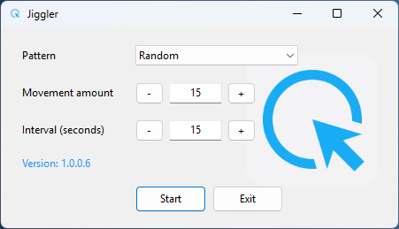

# Jiggler application for Delphi
A lightweight and simple application to allow the user to jiggle the on screen mouse cursor 

## 📁 Project Structure
/: Contains the project and group files

Source/: Contains the classes and the main form code

## 🚀 Features
* Pattern: A choice of "Up/Down", "Left/Right", "Random" and "Return to start position"

* Movement amount: A choice of 5,10,15,20 and 25

* Interval (seconds): A choice of 10,15,30,60 and 120

* Start/Stop: Click to start or stop

When a user minimizes the application it is placed onto the system tray

## 🛠 Installation
The Releases section contains all executables or zip files

1. Run the executable from a Zip file
You are not required to open the setup executable but you can instead select the zip file containing the latest x86 or x64  version of the application

2. Setup file
There are x86 and x64 variants of the setup application

## ⚠️ Important Note
Some companies are strictly against the use of mouse jiggling software and as such I cannot and will not be held responsible for the way or place you use this application.

## 📄 License
This project is licensed under the MIT License - see the LICENSE file for details.

---

## 📩 Contact & Support

If you have questions, find a bug, or want to suggest a feature for the **Windows Messaging Group**, feel free to reach out:

* **Maintainer:** Antony Danby
* **GitHub:** [@AntonyDanby](https://github.com/antonydanby)  
* **Email:** [info@latitude53north.co.uk](mailto:info@latitude53north.co.uk)  
* **Website:** [latitude53north.co.uk](https://latitude53north.co.uk)

> [!TIP]
> If you encounter an issue with this application, please include your Windows version in the [Issue Tracker](https://github.com/antonydanby/Jiggler/issues).
>
> 